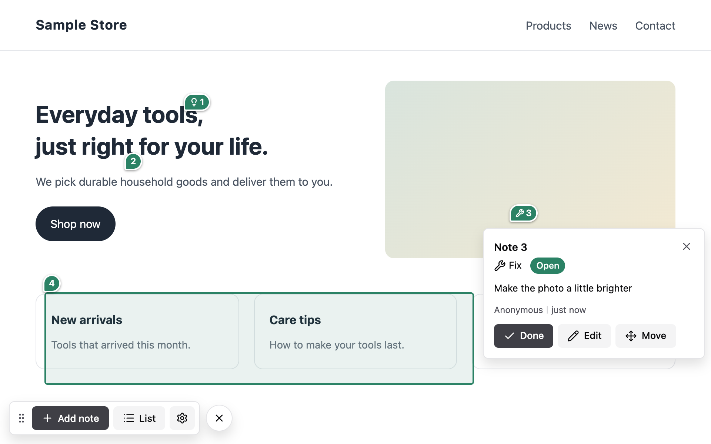
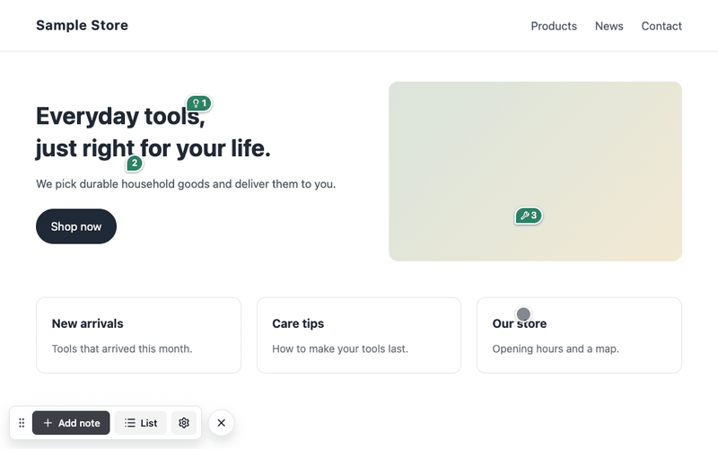
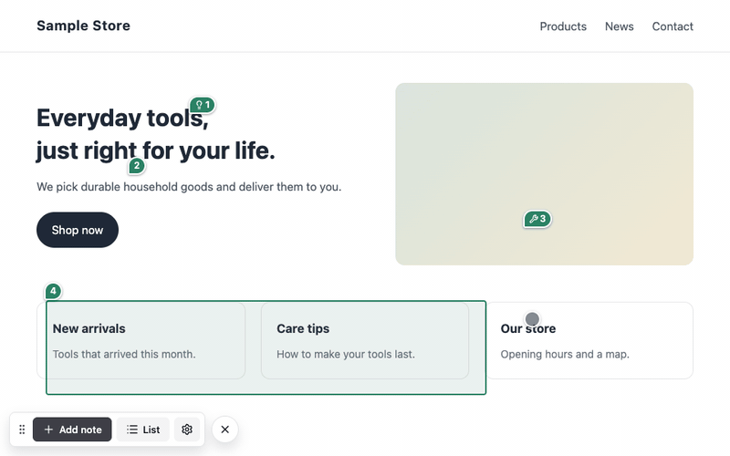

# Asternote

English | [日本語](README.ja.md)

Asternote lets you leave notes on a preview page with pins and areas.
Review a site in progress with your team, and record what you noticed or decided right where it is on the screen.
It has no dependencies and runs on one JS file and one PHP file.

## Screens



### Add a note at a point

Press "Add note", then click where you want the note. Write the text in the popover and save it.


### Add a note to an area

Press "Add note", then drag to draw an area.



### List and settings

"List" shows the notes on the page. The gear button opens the settings, where you can move the bar and more.



The page in these images is fictional and was made for this explanation.

## Files

| File | Role |
|---|---|
| `asternote.js` | Browser side. Shows the pins and writes notes |
| `api.php` | Server side. Saves the notes as JSON. PHP 7.4 or later |
| `export.mjs` | Exports the notes to Markdown. Node 18 or later |
| `copy.mjs` | When installed with npm, copies `asternote.js` and `api.php` to the public directory |
| `wordpress/asternote.php` | The WordPress plugin. The release zip contains it with `asternote.js` and `api.php` |

## Before you install

- Protect the whole site with Basic authentication. Asternote has no per-user permissions
- Store the notes on each project's own server. They are not stored in this repository
- Put the storage directory outside the document root

## Install 1: Node.js projects such as Astro

Install it from GitHub with npm. Specify the version with a tag.

```sh
npm i github:hgw/asternote#v0.11.2
```

`asternote-copy` copies `asternote.js` and `api.php` to the public directory.
With `--config`, it also copies the config file.
Add it to `package.json` so that it copies before every dev server start and build.

```json
{
  "scripts": {
    "predev": "asternote-copy public/asternote",
    "prebuild": "asternote-copy public/asternote --config asternote.config.php"
  }
}
```

Use `--config` only for production builds. The dev server does not run PHP, so it would serve a config file in the public directory as plain text. The config file contains the storage path and the project name.

Do not commit the copied files. Add `public/asternote/` to `.gitignore`.
The config file contains the storage path. If the project repository is public, do not commit the config file either.

Add the script tag to the page. In Astro, leave `data-endpoint` empty on the local dev server.

```astro
<script is:inline src="/asternote/asternote.js"
        data-endpoint={import.meta.env.DEV ? '' : '/asternote/api.php'}
        data-project="myproject" defer></script>
```

## Install 2: WordPress

Install it as a WordPress plugin. The plugin outputs the script tag and provides the API.

1. Download `asternote-wordpress-<version>.zip` from [Releases](https://github.com/hgw/asternote/releases)
2. In the admin screen, go to Plugins, Add New, Upload Plugin, then install and activate it
3. Add the constants to `wp-config.php`

   ```php
   define('ASTERNOTE_DATA_DIR', '/home/xxx/data/example.com/asternote');
   define('ASTERNOTE_PROJECT', 'myproject');
   ```

4. Protect the whole site with Basic authentication

| Constant | Meaning |
|---|---|
| `ASTERNOTE_DATA_DIR` | Required. Where the notes are stored. Put it outside the document root |
| `ASTERNOTE_PROJECT` | Optional. The unit the notes are stored in. Up to 40 lowercase letters, digits, `-`, and `_`. Defaults to `site` |
| `ASTERNOTE_ALLOW_ANONYMOUS` | Optional. `true` turns off the Basic authentication check. `1` and `'true'` also work |
| `ASTERNOTE_DEFAULT_ON` | Optional. `true` shows the notes to first-time visitors too. `1` and `'true'` also work |

Without `ASTERNOTE_DATA_DIR`, the plugin does nothing. It outputs neither the script tag nor the API. If you add the constants only to the test environment's `wp-config.php`, the plugin stays inactive even when it is installed in production.

The plugin also does nothing when `ASTERNOTE_PROJECT` has an invalid form. It writes the reason to the PHP error log.

The screen language follows the site language. Japanese sites get Japanese, and all other sites get English.

The API is served at `wp-admin/admin-ajax.php?action=asternote`. Pass this URL to `--endpoint` when you export. If the admin screen and the public site are on different hosts, also pass the public site's URL to `--site`.

To use mu-plugins, put the `asternote` folder from the zip in `wp-content/mu-plugins/`. Then add a loader file at `wp-content/mu-plugins/asternote-loader.php`.

```php
<?php
require __DIR__ . '/asternote/asternote.php';
```

## Install 3: static sites and others

Load `asternote.js` from jsDelivr. Only `api.php` and the config file go on your server.

1. Put `api.php` in the server's public directory. For example, `/asternote/api.php`
2. Put `asternote.config.php` next to `api.php`

   ```php
   <?php return [
       'data_dir' => '/home/xxx/data/example.com/asternote',
       'projects' => ['myproject'],
   ];
   ```

3. Add the script tag to the page

   ```html
   <script src="https://cdn.jsdelivr.net/gh/hgw/asternote@v0.11.2/asternote.js"
           data-endpoint="/asternote/api.php"
           data-project="myproject" defer></script>
   ```

Download `api.php` from the same version tag as the script tag.

## Config file

These are the values for `asternote.config.php`.

| Key | Meaning |
|---|---|
| `data_dir` | Required. Where the notes are stored. If it points inside the document root, api.php stops with a 500 |
| `projects` | Required. An array of the allowed `data-project` names. Other names cannot create a storage file. Without it, api.php stops with a 500 |
| `allow_anonymous` | Optional. `true` turns off the Basic authentication check |

api.php rejects requests that have not passed Basic authentication with a 403. This keeps it from running when you forget to set up authentication.

- The check uses `REMOTE_USER` and `REDIRECT_REMOTE_USER`, which the server passes to PHP after it verifies the user name and password
- The local `php -S` has no Basic authentication. Set `allow_anonymous` to `true` only when you try it locally
- Servers that do not pass the Basic authentication user to PHP also need `allow_anonymous`

There are also these limits.

- Up to 2000 notes per project
- Up to 64 KB per write request

## Script tag attributes

| Attribute | Meaning |
|---|---|
| `data-endpoint` | The URL of api.php. Without it, the notes are stored in the browser's localStorage |
| `data-project` | The unit the notes are stored in. Lowercase letters, digits, `-`, and `_` |
| `data-ui="none"` | Hides the "Notes" button at the bottom left. Use the API from your own UI instead |
| `data-default="on"` | Shows the notes to first-time visitors too. Once a viewer shows or hides them, that choice wins |
| `data-lang` | The screen language, `ja` or `en`. Without it, the browser language decides, and anything other than Japanese gets English |

Clicks inside page elements with `data-asternote-ignore` are not used to place notes. Use it on UI that works alongside the tool, such as a settings panel.

While the notes bar or the list is shown, the CSS variable `--asternote-offset` is set on `html`. Its value is the height from the bottom of the screen to the top of the bar or the list, without any margin. Other elements at the bottom left can add a margin, for example `bottom: max(16px, calc(var(--asternote-offset, 0px) + 8px))`.
When a viewer moves the bar off the bottom edge, `--asternote-offset` is not set.

## Customizing the look

You can change the colors and the corner radius with CSS variables. Set `--asternote-*` on `html` or another element.

```css
html {
  --asternote-primary: #1e3a8a;
  --asternote-radius: 4px;
}
```

| Variable | Meaning | Default |
|---|---|---|
| `--asternote-fg` | Text color | `#09090b` |
| `--asternote-muted` | Secondary text color | `#52525b` |
| `--asternote-bg` | Background of the bar and popovers | `#fff` |
| `--asternote-subtle` | Button background | `#f4f4f5` |
| `--asternote-input` | Input border | `#71717a` |
| `--asternote-primary` | Key color. Background of the main buttons and selected buttons | `#3f3f46` |
| `--asternote-ring` | Focus ring | `#3f3f46` |
| `--asternote-danger` | Delete color | `#b91c1c` |
| `--asternote-open` | Color of open pins | `#2b8265` |
| `--asternote-done` | Color of done pins | `#52525b` |
| `--asternote-star` | Color of the importance stars | `#2b8265` |
| `--asternote-radius` | Corner radius | `8px` |

The defaults meet the WCAG 2.2 AA contrast requirements. Keep these ratios when you change them.

- At least 4.5:1 between text and its background. White text sits on the status colors
- At least 3:1 between the background and the input border or the focus ring

## Accessibility

Asternote aims for WCAG 2.2 AA.

- The bar, popovers, and the list work with the keyboard alone
- Placing a note and moving a pin also work with the keyboard. Move the crosshair cursor with the arrow keys and press Enter. Hold Shift with the arrow keys to move faster
- Areas and pin moves can be set with clicks alone, without dragging
- Pins can be reached with Tab. Enter opens the popover, and Esc closes it and returns focus to the pin
- Whether a note is done is shown with an icon as well as a color. Done pins get a check mark
- Screen readers announce each pin's number, status, type, whether it is an area, and its importance
- The tool's elements carry a `lang` attribute, so screen readers read them correctly even when the page is in another language

The keyboard crosshair cursor moves only within the visible screen. To place a note outside it, scroll the page first.

## JavaScript API

```js
Asternote.enable();   // Show the notes
Asternote.disable();  // Hide the notes
Asternote.toggle();
Asternote.isEnabled();
Asternote.onChange((enabled) => { ... });
```

An `asternote:ready` event fires on `document` when the script has loaded.

## Usage

- Press "Add note" in the bar, then click where you want a point, or drag to draw a rectangular area
- Check "Select area" to draw an area by clicking two corners in turn. This is for people who cannot drag
- Pressing "Add note" with the keyboard shows a crosshair cursor. Move it with the arrow keys and press Enter to place the note
- While you place a note, the bar shows only the back icon and the "Select area" checkbox. The back button or Esc stops placing
- The placing hints are not shown on screen. Screen readers announce them
- While you write a new note, a dashed draft pin and area outline stay where you placed it. Saving turns it into a real pin, and cancelling removes it
- The × at the right of the bar closes the notes
- An area is shown as an outline with a numbered pin at its top left. It is recorded relative to the nearest common parent of both corners
- You can drag a placed pin. For an area note, the whole area moves. The anchor is recalculated where you release it, then saved
- You can also press "Move" in the popover and click the destination. An area note keeps its size and moves its top left corner to where you clicked
- Clicking a pin lets you read the text, mark it done or open, and edit it. Delete it from the trash button in the edit popover. The first press asks "Really delete?", and the second press deletes it
- In the text field, ⌘ / Ctrl + Enter also saves
- Clicking outside a popover closes it. A popover with unsaved text stays open so you do not lose it by accident
- A note is either open or done. New notes start open. "Done" in the popover marks it done, and "Mark as open" reverts it
- Open pins are green, and done pins are gray with a check mark
- There are five types: Note, Idea, Fix, Question, and Like. All types except Note show an icon before the pin number
- Importance is 0 to 3 stars. 0 means none. The stars appear in the popover and the list, not on the pin
- Done notes are shown only when "Show done notes" is checked in the settings. The checkbox state is saved in the browser
- Pin numbers follow the creation order, including done notes. Hiding done notes does not shift the numbers
- Notes without a name show "Anonymous". The Japanese screen shows "ななしさん". The saved name stays empty
- Times within the last week are relative, such as "5 min ago" or "17 hr ago". Older ones show the date. Hover to see the exact time
- "List" shows the notes on the page
- A pin is recorded relative to the clicked element. If the element disappears, the pin is shown at the recorded position with a dashed outline
- Pins inside fixed elements or scrolling containers are repositioned as you scroll
- If an element is nested so deeply that its selector is too long, the nearest parent that fits the limit is used as the anchor

## Settings

The gear button in the bar opens the settings panel. The settings are saved in the viewer's browser, separately for each site.

- Show done notes: off by default
- Keyboard shortcut: on by default. While the notes are open, each press of the key toggles placing mode
- Key to add a note: C by default. One letter or digit. Case does not matter
- Hide the bar: off by default. When on, the bar stays hidden even while the notes are open. Pressing the key shows the bar and starts placing mode. The bar hides again once placing mode, popovers, the list, and the settings are all closed
- Bar position: opens when you press the heading. Choose from the four corners and the middle of each edge. "Reset position" returns the bar to the bottom left
- Version: shown at the bottom of the panel. Clicking it opens the GitHub repository in a new tab

The key does nothing while the notes are closed and only the launcher button is visible. It also does nothing while focus is in an input or an editable element. It ignores presses with Ctrl, ⌘, or Alt, and presses during Japanese input conversion.

Turning on "Hide the bar" also turns on "Keyboard shortcut". Turning off "Keyboard shortcut" also turns off "Hide the bar". This keeps a way to bring the hidden bar back.

Drag the grip at the left end of the bar to move it. When you release it, it snaps to the nearest edge. It can sit anywhere along an edge. Within 24 px of an end, it snaps to the corner. The list and settings panels open from the bar toward the inside of the screen.

## Export

Export the notes to Markdown. In projects installed with npm, `npx asternote-export` also works.
Put the Basic authentication user name and password in `ASTERNOTE_AUTH`. To keep them out of your shell history, load them from a password manager.

```sh
ASTERNOTE_AUTH="user:pass" node export.mjs \
  --endpoint https://example.com/asternote/api.php \
  --project myproject \
  --lang en \
  --out docs/notes.md
```

`--lang en` writes English headings and labels. Without it, the output is in Japanese.

The output lists the notes by page. Within each page, open and done notes are listed separately. Dates use the local time of the machine running the export. Area notes get "[Area]", types other than Note get their type name such as "[Fix]", and importance gets stars.

## Storage

Only the presence of `data-endpoint` decides where the notes are stored.

- With `data-endpoint`, the notes are always saved to api.php. 403, 401, 5xx, and WAF error pages are shown as errors, and the storage does not switch
- Without `data-endpoint`, the notes are saved in the browser's localStorage
- Guessing whether PHP is available from the response shape is not used. It would be fooled by WAF pages or redirects to login screens, and notes would never reach the server
- Leave `data-endpoint` empty on the local dev server. In Astro, `import.meta.env.DEV` tells them apart

## API errors

api.php returns errors as `{"error": "...", "code": "..."}`. `error` is a Japanese sentence, and `code` is a symbol for the kind of error.
The screen uses `code` to show the message in the viewer's language. For an unknown `code`, it shows the `error` sentence as it is.

## Safety measures for saving

- If the storage file cannot be read, api.php treats it as a temporary I/O error and returns a 500. It leaves the file alone
- If the stored data is corrupted, api.php does not overwrite it
  - Reads return an empty list and report it with the `X-Asternote-Warning` header. A notice appears in the notes bar
  - Updates and deletes stop with a 409. This prevents all notes from disappearing silently
  - Only when creating a note, the file is moved to `<name>.json.corrupt-<time>` and saving starts over from empty. You can restore the contents by hand
- Writes go to a temporary file first, which then replaces the original. On failure, an error is returned and the original file stays
- Reads take a shared lock, and writes take an exclusive lock

## Catalog page

`dev/catalog.html` is a development page that shows the design tokens, icons, and components on one page.
Run `php -S 127.0.0.1:8767` at the repository root, then open `http://127.0.0.1:8767/dev/catalog.html`.
The token defaults and icons are read from `asternote.js`. The component HTML is written by hand, so update it when you change a component.
This page is in neither the npm package nor the WordPress zip.

## Migrating from pin-notes

In v0.8.0, the name changed from pin-notes to Asternote.
The old attributes, constants, and commands are no longer read. Update existing projects as follows.

- Change the npm spec to `github:hgw/asternote#<version>`, using v0.8.0 or later
- Change the commands in `package.json` to `asternote-copy` and `asternote-export`
- Rename the copy destination and the `.gitignore` entry to `asternote` if needed
- Rename the config file to `asternote.config.php`
- Change the script tag's `src` to `asternote.js`
- Change `data-pin-notes-ignore` to `data-asternote-ignore`
- Change the CSS variables `--pin-notes-*` to `--asternote-*`
- Change `window.PinNotes` to `window.Asternote`, and `pin-notes:ready` to `asternote:ready`
- Change the export environment variable to `ASTERNOTE_AUTH`

For WordPress, replace the plugin as follows.

1. Deactivate and delete the old plugin
2. Install and activate `asternote-wordpress-<version>.zip`, v0.8.0 or later
3. Rename the constants in `wp-config.php` from `PIN_NOTES_*` to `ASTERNOTE_*`. If you forget, the plugin does nothing
4. Change the export `--endpoint` to `admin-ajax.php?action=asternote`

Notes stored on the server keep working. You do not need to move the storage directory, because the file name depends only on the project name.
Notes stored in localStorage are not carried over. localStorage is for local checks only.

Tags up to v0.7.0 are kept. GitHub redirects the old repository URL, so projects that point to old tags keep working.

## License

MIT. See [LICENSE](LICENSE) for details.
For bug reports and pull requests, see [CONTRIBUTING.md](CONTRIBUTING.md). To report a vulnerability, see [SECURITY.md](SECURITY.md).
